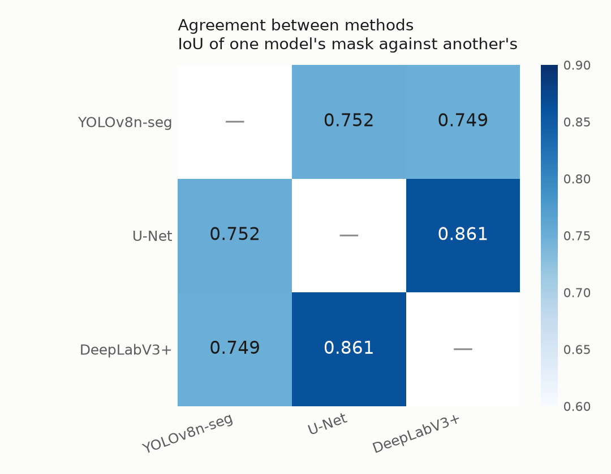
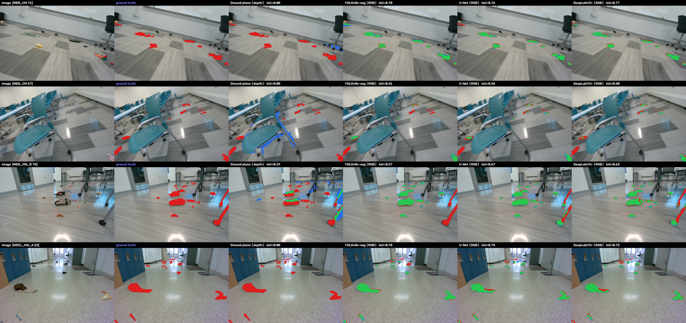
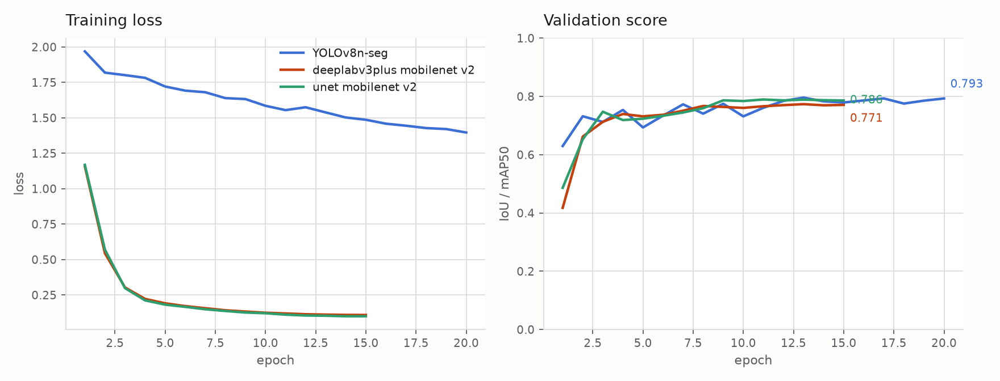
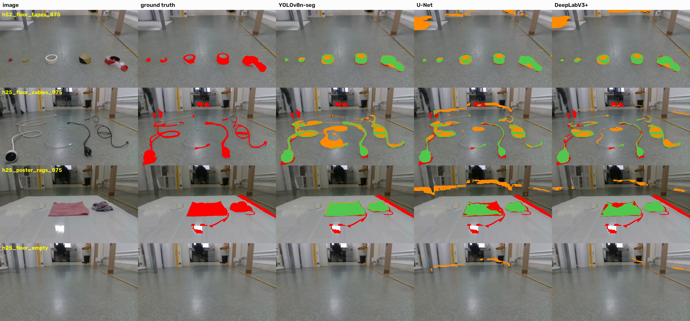

# Low-lying obstacle detection: RGB vs. depth vs. RGB-D

Course project (ITR, CS-8813). Do RGB, depth, and RGB-D differ in how well they detect
small low-lying obstacles on indoor floors (cables, gloves, screws and similar)? A second
question: can masks generated by a foundation model (SAM) replace hand labels for training
a lightweight model?

Background, decisions and the evaluation plan: [`NOTES.md`](NOTES.md).
Bibliography report: [`bibliography_report/`](bibliography_report).

## Dataset

[ISOD](https://www.kaggle.com/datasets/yuchen66/indoor-small-object-dataset) (Chen et al.,
2023, the MOSTS paper). 20 indoor sites, 100 frames each. Per frame: `rgb/`, `depth/`
(16-bit, millimetres), `label/` (hand-drawn, 255 = drivable floor) and `mask/` (the RGB
image with everything the authors' depth ground-plane method judged not-floor blacked out).
Per site: `imu/imu.csv` and `ref.jpg`, a photo of the floor texture.

The dataset is not in this repo (2.5 GB). Fetch it with:

    kaggle datasets download yuchen66/indoor-small-object-dataset -p data --unzip

### Obstacle ground truth

ISOD labels the drivable floor, not the objects, so walls, furniture and the objects are
all "not drivable" alike. `isod.obstacles()` recovers the objects: in the not-drivable
mask, the walls and every piece of furniture touching them form one big connected
component. Dropping it (and blobs under 20 px) leaves the blobs enclosed by floor, which
are the objects lying on the floor. About 8.8 objects per frame.

Known limits: objects touching the wall region are dropped with it; the annotators traced
coiled cables as filled blobs, so cable masks are coarse.

Depth is never used to build the ground truth — only as a method being scored.

## Layout

    code/
      isod.py         paths, splits, ground truth, depth baseline, metrics
      prep_gt.py      writes data/ISOD_gt/, data/splits.json, a contact sheet
      to_yolo.py      exports data/yolo/ (images + polygon labels, one class)
      eval.py         scores any method against the ground truth
      train_yolo.py   fine-tunes yolov8n-seg, writes test masks, reports FPS
      train_seg.py    trains U-Net / DeepLabV3+ on the masks directly
    data/             dataset, derived ground truth, splits (not in the repo)
    explore/          sample sheets for eyeballing the data (not in the repo)
    bibliography_report/   REPORT.md -> REPORT.tex -> PDF, IEEE format

## Running it

    python3 -m venv .venv && .venv/bin/pip install numpy pillow opencv-python-headless

    cd code
    python prep_gt.py          # ground truth + splits + contact sheet
    python eval.py depth test  # depth-only baseline
    python to_yolo.py          # YOLO dataset

On a GPU server (`/opt/venv/jdusza_venv` on shire, see `../GTE_SERVERS.md`):

    CUDA_VISIBLE_DEVICES=0 python train_yolo.py --root /data/cs_courses/jdusza_itr
    CUDA_VISIBLE_DEVICES=0 python train_seg.py --arch unet --encoder mobilenet_v3_large
    CUDA_VISIBLE_DEVICES=0 python train_seg.py --arch deeplabv3plus --encoder mobilenet_v3_large

    python eval.py masks /data/cs_courses/jdusza_itr/pred/yolo test

## Splits

By site, so test rooms are never seen in training: 14 sites train, 3 val, 3 test
(`data/splits.json`).

## Metrics

Everything is scored as mask overlap on the obstacle class, over the 300 test images:

- **IoU** — overlap between predicted and true obstacle pixels, divided by their union. The headline number.
- **Precision** — share of predicted obstacle pixels that are real obstacles.
- **Recall** — share of real obstacle pixels that were predicted. For a robot a miss is
  worse than an oversized mask, so recall matters more than precision.

Walls and furniture are ignored: they are labelled not-drivable but are not our objects,
so predicting them neither helps nor hurts. Test sites are never seen during training.

## Models

All three are pretrained (COCO for YOLO, ImageNet for the encoders) and fine-tuned on the
1,400 training images with one class, "obstacle".

- **[YOLOv8n-seg](https://docs.ultralytics.com/tasks/segment/)** — instance segmentation:
  one box plus one mask per object, in the smallest ("nano") size. Built for real-time use
  on weak hardware, and the model the related work uses for the lightweight RGB method.
  Trains on polygon outlines rather than mask images, so thin shapes lose some accuracy.
- **[U-Net](https://arxiv.org/abs/1505.04597)** — semantic segmentation: mask in, mask out,
  no objects. An encoder shrinks the image, a decoder grows it back, and skip connections
  pass fine detail straight across, which is what keeps small objects sharp.
- **[DeepLabV3+](https://arxiv.org/abs/1802.02611)** — also semantic. Instead of skip
  connections it uses dilated convolutions at several rates, so each pixel is judged with
  wide context. Strong on large regions, and here slightly behind U-Net on small ones.

Both semantic models use a **[MobileNetV2](https://arxiv.org/abs/1801.04381)** encoder, a
lightweight backbone meant for phones and embedded devices, via
[segmentation_models_pytorch](https://github.com/qubvel-org/segmentation_models.pytorch).

## Results

| Method | Input | IoU | Precision | Recall |
|---|---|---|---|---|
| Ground-plane segmentation (ISOD `mask/`) | depth | 0.031 | 0.132 | 0.039 |
| YOLOv8n-seg | RGB | 0.744 | 0.883 | 0.826 |
| **U-Net (MobileNetV2)** | RGB | **0.776** | 0.906 | 0.844 |
| DeepLabV3+ (MobileNetV2) | RGB | 0.757 | 0.903 | 0.824 |

The depth-only ground-plane method finds almost nothing: these objects are about 3 cm
tall or less, which is below what the plane fit separates from the floor. Every RGB model
lands near 0.75–0.78 IoU, and the three differ far less from each other than any of them
differs from depth. U-Net is slightly ahead of YOLO, which has to go through polygons and
loses accuracy on thin shapes.

Training is cheap: YOLO 20 epochs in about 3 minutes on one RTX 3090, the two semantic
models 15 epochs in about 5 minutes each.

Longer training does not help: 80 epochs of YOLO gave test IoU 0.737 against 0.744 at 20
epochs (recall up, precision down more). Training loss keeps falling but the validation
score plateaus around epoch 12–15 for every model.

### Agreement between methods

Pairwise IoU of the predicted masks — how much two models agree with each other, ignoring
the ground truth (`agreement.py`; the depth baseline agrees with nothing and is left out).
U-Net and DeepLabV3+ agree at 0.861, higher than either scores against the ground truth
(0.776 / 0.757). The RGB models therefore miss the same pixels — small distant objects,
thin cables, reflections — rather than making independent mistakes, so combining them
would gain little.

*Per method: green = correct, red = missed, blue = false positive. Depth (column 3) misses
nearly everything; the RGB models catch most objects and disagree mainly on small distant
ones and on reflections.*

## Our own recordings: does any of this transfer?

A second dataset, recorded in one GTE lab room with an Intel RealSense D435: **64 runs, 320
frames**, two camera heights, three distances, two backgrounds, seven object sets. Full
description, grid and method: [`data_collection/DATASET.md`](data_collection/DATASET.md);
capture protocol: [`data_collection/PLAN.md`](data_collection/PLAN.md); per-run index:
[`data_collection/dataset_index.csv`](data_collection/dataset_index.csv).

Ground truth is derived without hand labelling: every run in a group was shot from the same
pose at the same tape line with a different set of objects, so the per-pixel median across the
group is the empty scene, and differencing against it gives the obstacle mask. On the empty
runs the method returns **0 objects, 0 px** — that is its noise floor. 51 of 64 runs pass the
reliability check and are used below; the rest are kept but excluded from every metric.

The three RGB models are the ISOD-trained checkpoints, **frozen**: no fine-tuning, same
threshold.

| Method | IoU | Precision | Recall | ISOD IoU |
|---|---|---|---|---|
| **YOLOv8n-seg** | **0.253** | 0.436 | 0.377 | 0.744 |
| U-Net (MobileNetV2) | 0.158 | 0.204 | 0.411 | 0.776 |
| DeepLabV3+ (MobileNetV2) | 0.201 | 0.296 | 0.385 | 0.757 |

**The drop is the result.** Every model loses two thirds to four fifths of its IoU on a different
camera in a different room. Nothing about 0.75 IoU on ISOD survives contact with new data, and
the ranking inverts: YOLOv8n-seg, the weakest of the three on ISOD, is the strongest here.

**Mounting height matters more than the model.** Averaged over the bare-floor runs:

| | 0.87 m | 1.56 m | 2.60 m |
|---|---|---|---|
| YOLOv8n-seg, camera at 52 cm | 0.419 | 0.172 | 0.042 |
| YOLOv8n-seg, camera at 25 cm | 0.474 | **0.464** | **0.419** |
| DeepLabV3+, camera at 52 cm | 0.256 | 0.118 | 0.067 |
| DeepLabV3+, camera at 25 cm | 0.489 | 0.348 | 0.243 |

At 52 cm performance collapses beyond a metre. At 25 cm it is flat out to 2.6 m, and the
effect holds for every model: overall IoU roughly doubles (YOLO 0.148 -> 0.396, DeepLabV3+
0.120 -> 0.330, U-Net 0.108 -> 0.239). Halving the camera height buys more than any
architecture change we have measured — and the same ordering
was predicted from the depth geometry (`SNR ∝ 1/(h·d)`) before the data was recorded.

**Low contrast breaks everything.** On the white poster, where pale objects nearly vanish, IoU
falls from 0.344 to 0.147 for YOLO, and the hardest single object in the set — a white rag on
the white poster — is missed by all three. This is the condition ISOD does not contain.

**False positives on an empty floor**, where every predicted pixel is wrong by construction:

| Method | predicted px per frame | runs with any prediction |
|---|---|---|
| YOLOv8n-seg | **0** | 0/4 |
| U-Net | 8,999 | 4/4 |
| DeepLabV3+ | 4,657 | 4/4 |

The semantic models hallucinate obstacles on bare floor; the instance model does not. For a
robot that is the difference between a usable perception stack and one that stops constantly.
It also explains the precision gap in the table above, and it is invisible on ISOD, which has
no empty-floor frames.

*Green = correctly found, red = missed, orange = false positive. Rows: tape rolls at 0.87 m
(the easiest case), stretched cables at 25 cm, rags on the white poster (note the white rag,
bottom left of its panel, which all three models miss), and an empty floor.*

### What this does not yet show

Depth and RGB-D are not in this table. Those checkpoints live in a collaborator's home
directory on the GPU server and are not readable from this account, so the modality comparison
on our own data needs them retrained first — the training script is on the `juan-rgbd` branch
and the aligned depth is already in the dataset.

## Next

See [`ROADMAP.md`](ROADMAP.md): a fair learned depth-only baseline, RGB-D fusion, SAM
pseudo-labels versus hand labels, per-class numbers, and our own robot recordings.
