# GTE-Floor: RGB-D recordings of low-lying floor obstacles

64 runs, 320 annotated frames, one indoor lab room, an Intel RealSense D435 mounted on a
TurtleBot. Recorded 2026-10-12 to answer two questions that
[ISOD](https://www.kaggle.com/datasets/yuchen66/indoor-small-object-dataset) cannot:

1. **Does anything learned on ISOD transfer** to a different camera, room and mounting height?
2. **What happens when an obstacle is hard to see in RGB?** ISOD contains no controlled
   variation of obstacle visibility, so it cannot separate "depth is useless" from "RGB
   happened to be sufficient in every ISOD frame".

Capture protocol: [`PLAN.md`](PLAN.md) · run sheet: [`runs.xlsx`](runs.xlsx) · per-run index:
[`dataset_index.csv`](dataset_index.csv) · results: [`../README.md`](../README.md).

---

## 1. The rig

The camera is the robot's camera: a RealSense D435 on a small tripod bolted to a TurtleBot
(Kobuki base), so the viewpoint is the one a real robot would have rather than a convenient
one.

| camera at **52 cm** (the robot's own deck) | camera at **25 cm** (lower deck) |
|---|---|
| 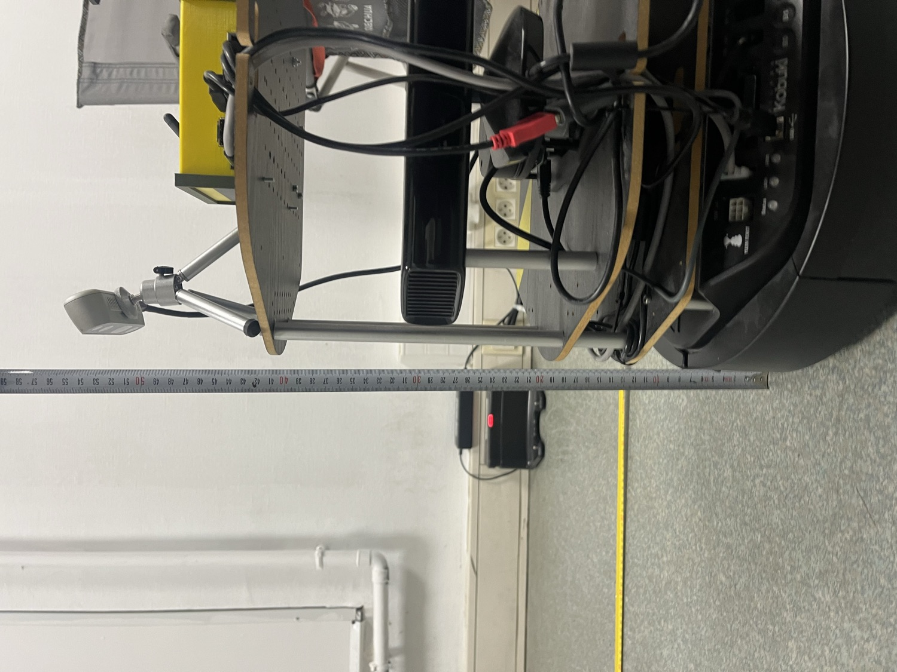 | 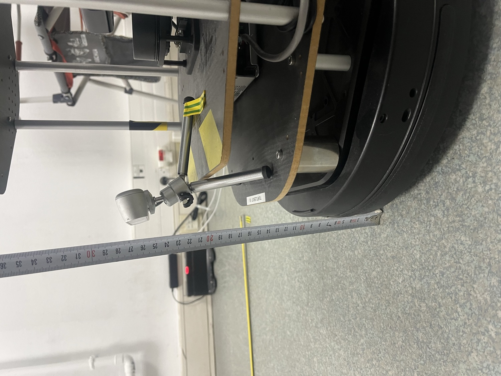 |
| tilt 30°, bottom-centre of the depth frame reads 0.56–0.61 m | tilt 21°, bottom-centre reads 0.33 m |
| floor visible from 0.67 m to 3.3 m | floor visible from 0.37 m to the horizon |

Every run was shot at **both** heights with everything else identical, because the geometry
predicts height is the dominant variable. For an obstacle of height `Δh` at distance `d` seen
from height `h`, the grazing view turns height into a range difference of `Δh·d/h`, against
stereo noise `σ = k·d²`:

```
SNR = Δh / (h · k · d)          k ≈ 0.0045 m⁻¹ for this D435
```

So halving the mount height should double depth's signal-to-noise at every distance. The two
blocks exist to test that, and the same comparison turns out to matter for RGB as well.

### Distances

Three tape marks on the floor at 0.75 / 1.5 / 2.5 m from the point below the lens, which the
camera reads as slant ranges of **0.87 / 1.56 / 2.60 m**. They were chosen so a 4 mm cable sits
*above* the stereo noise at the near mark and *below* it at the far one — predicted SNR 2.0 /
1.1 / 0.7 at 52 cm, double that at 25 cm. A ladder where the answer is obvious at both ends
would measure nothing.

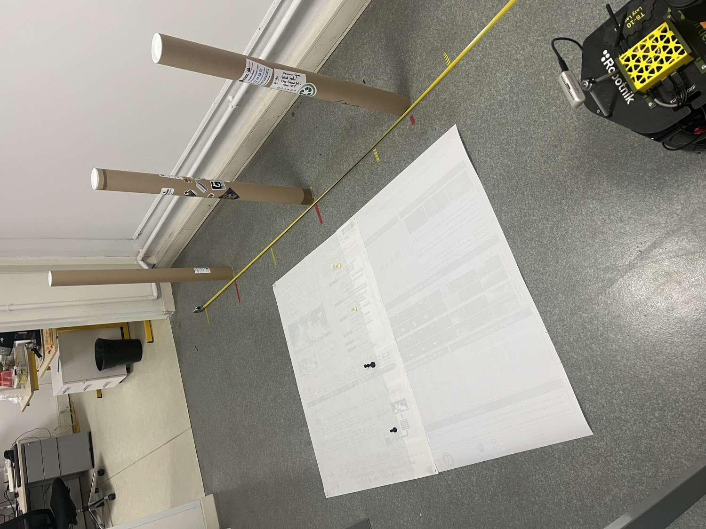

*Chess pieces on the white poster at the 1.5 m line, 52 cm block. The yellow measuring tape
runs along the floor with the three marks on it; the robot with the camera is bottom right.*

Cardboard tubes were stood at the marks so the distances would be visible in depth as well as
in colour — tape is invisible to a depth sensor. Two fell outside the colour camera's narrower
70° view, but the one at the 1.5 m mark is in frame in both blocks and reads **1.47 m** at
52 cm and **1.52 m** at 25 cm. A vertical tube spans from the floor's slant range at its base
to the horizontal distance at camera height, so those values sit exactly where they should,
and they confirm the distance marks and the depth alignment against an object you can point
at rather than against the fitted ground plane. The tubes play no part in the ground truth:
being static and present in every run of a group, the median background absorbs them like any
other fixture.

### Backgrounds

Two: the bare speckled lab floor, and a **white poster** laid over the same spot. The poster is
not there for variety — it is there to flip which objects are hard to see while leaving their
geometry untouched. A white rag on a grey floor is easy for RGB; the same rag on white paper is
nearly invisible, and depth doesn't care either way. That dissociation is the whole point.

---

## 2. The object sets, and why each one exists

Seven sets, one per run, laid across the tape line about 20 cm apart (closer and the scoring
merges them into one connected component). Two properties drive every result: **height above
the floor**, which decides whether depth can resolve an object against its noise, and
**contrast against the background**, which decides whether RGB can.

### 1. Cables — thin-linear (C1)

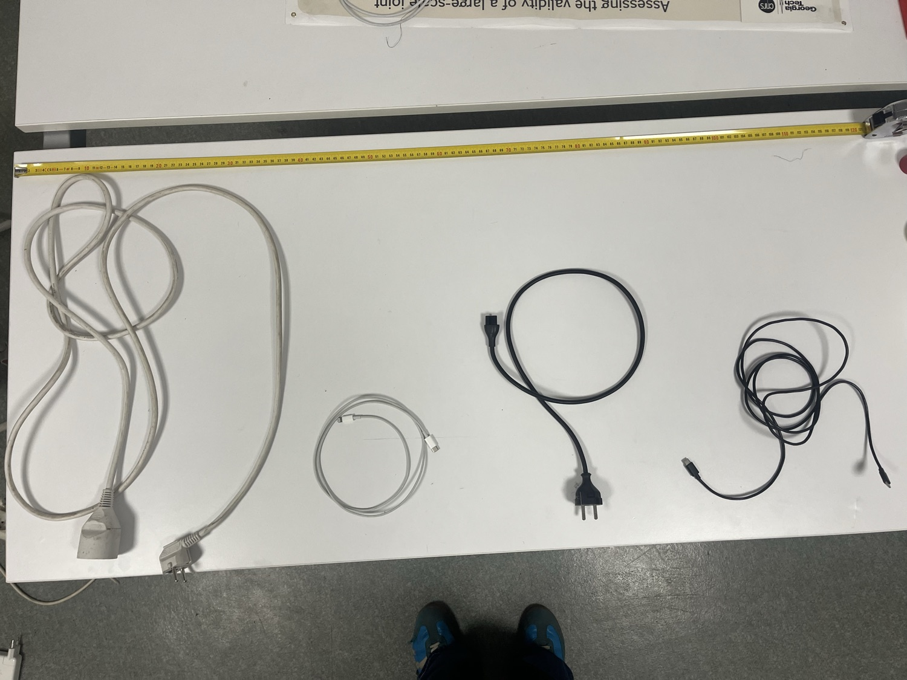

Four cables crossed by **colour × thickness**: black thin, black thick, white thin, white
thick. 2–6 mm tall, so depth is at the edge of its noise floor at the near mark and hopeless at
the far one. Laid in open S-curves rather than coils, so they stay genuinely thin — coiled
cables become compact blobs, which is exactly the flaw ISOD's own annotations have.

The thickness pairing separates "too thin to see" from "too low to measure": a thick white
cable and a thin white cable have the same contrast but different height and width.

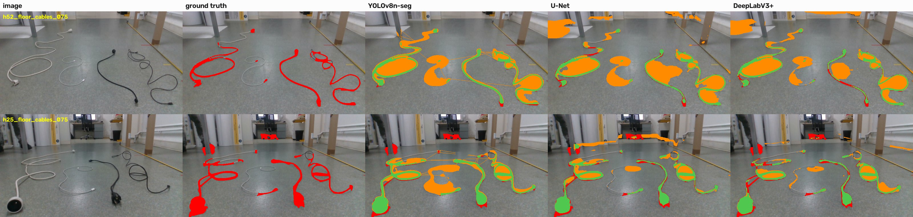

*Every run of this set: both camera heights, both backgrounds where recorded, all three
distances. Green = found, red = missed, orange = false positive. Where the derived mask did
not pass the reliability check the ground-truth column says so and the predictions are shown
in plain blue, since there is nothing trustworthy to compare them against.*

### 2. Tape rolls — raised, graded (C4)

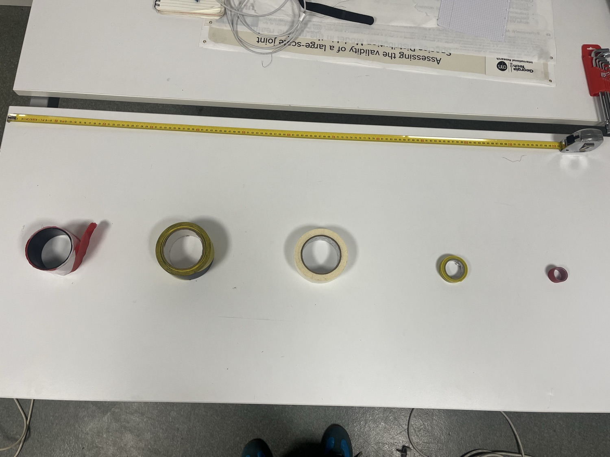

Five rolls spanning roughly 20–50 mm in height. **This is the positive control**: depth *must*
find a 50 mm object at 0.87 m, where its predicted SNR is above 20. If it cannot, the depth
pipeline is broken and nothing else in the dataset is interpretable. The graded diameters also
give a height ladder inside a single object type, with colour and material held constant.

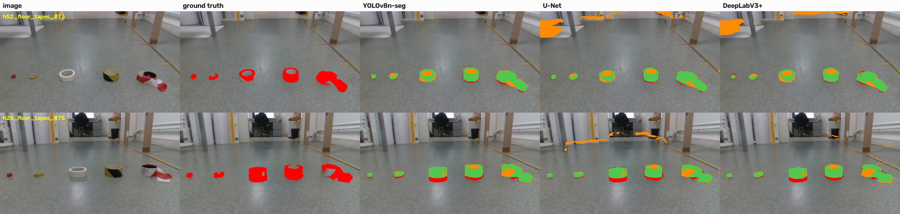

### 3. Hex keys — thin, metallic, specular

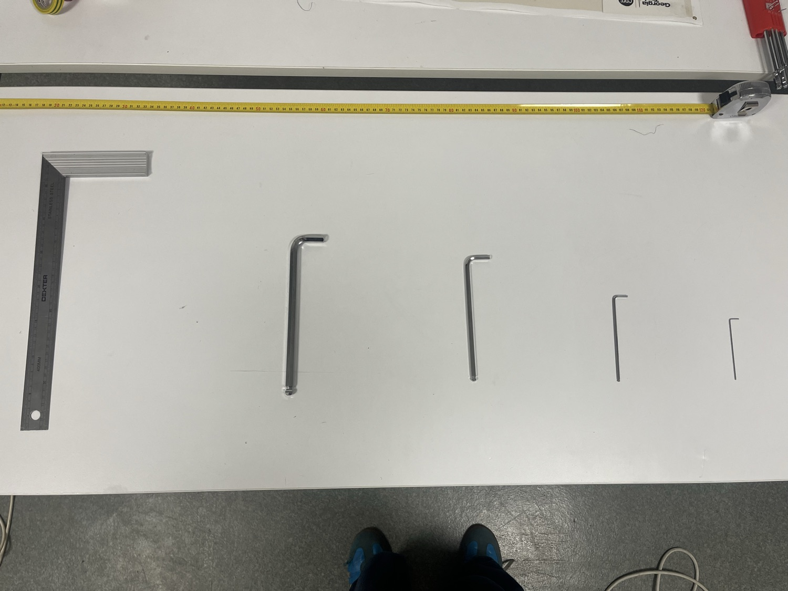

Five sizes of the same shape. Thin enough that depth is blind, but dark and shiny against a
pale floor, so RGB has strong local contrast on a tiny area. They also test the specular case:
stereo matching tends to fail on shiny surfaces and return *no* depth there, which is a
different failure mode from measuring the floor correctly.

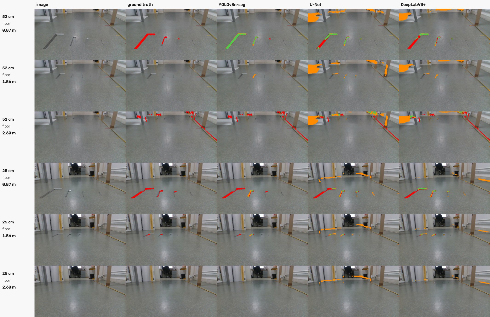

### 4. Random clutter — mixed heights

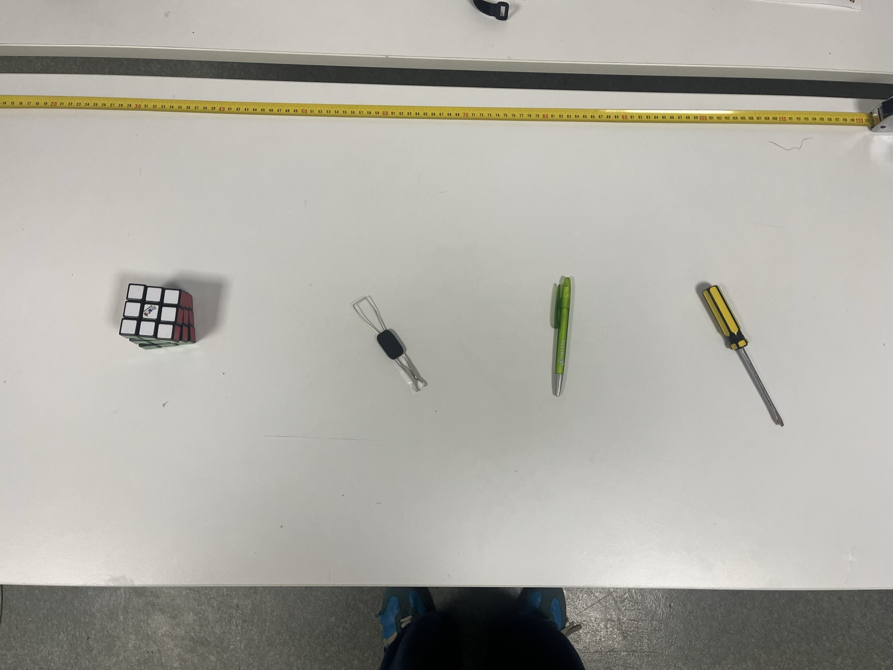

Screwdriver, Rubik's cube, pen, keycap remover: everyday objects spanning about 8 mm to 57 mm
in a single frame. This is the realism check — one frame containing an object depth should
find, one it should miss, and two in between, with no curation by colour.

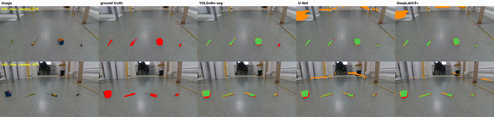

### 5. Screws — the small limit, plus a pile

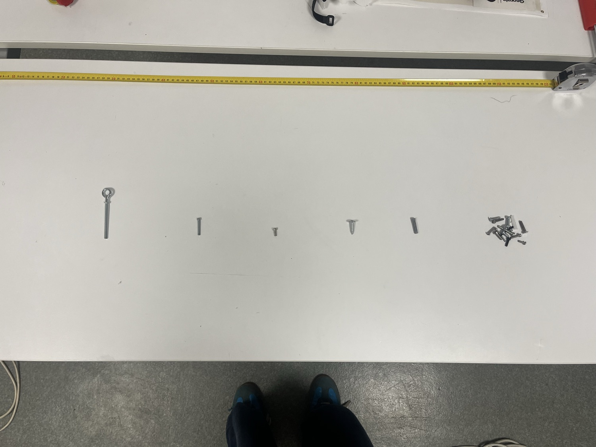

Five single screws of different sizes **and one pile**. The singles probe the smallest object
either modality can resolve; at 2.60 m a screw is a handful of pixels and below even the 20-px
minimum the ground truth enforces. The pile tests whether clustering rescues them: the same
material at the same height, but an order of magnitude more pixels.

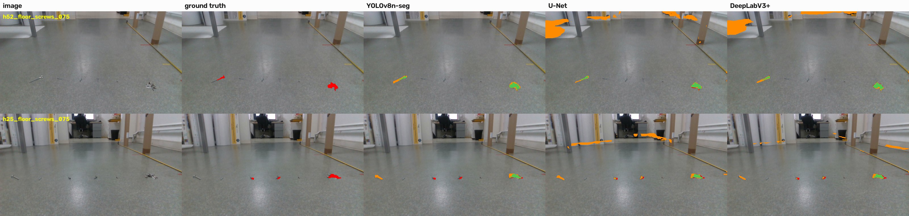

### 6. Chess pieces — colour × height, fully crossed

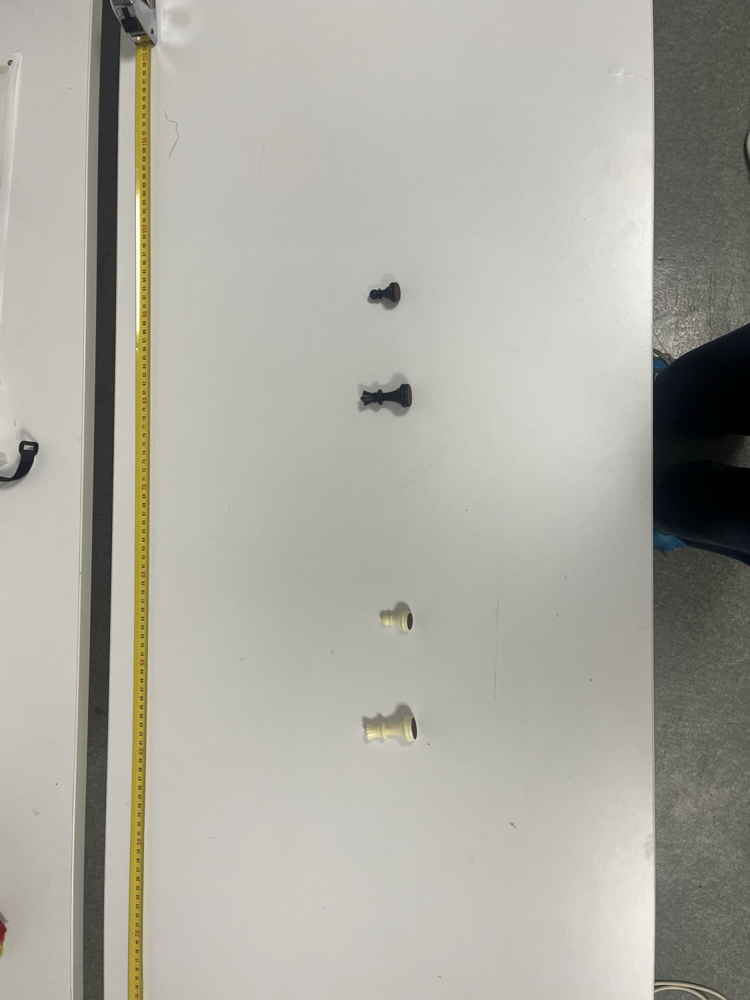

White queen, white pawn, black queen, black pawn: the cleanest dissociation in the dataset.
Queen and pawn differ in height by roughly a factor of two; white and black differ only in
albedo. **Depth should be indifferent to colour and sensitive to height; RGB should be the
opposite.** Put the same four pieces on the white poster and the white ones nearly vanish for
RGB while their geometry is unchanged — if depth's score holds and RGB's collapses, the two
modalities have been cleanly separated by a single variable.

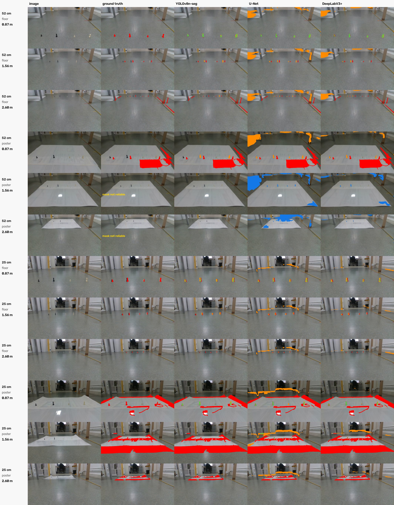

### 7. Rags — colour × flatness, and the hardest item in the set

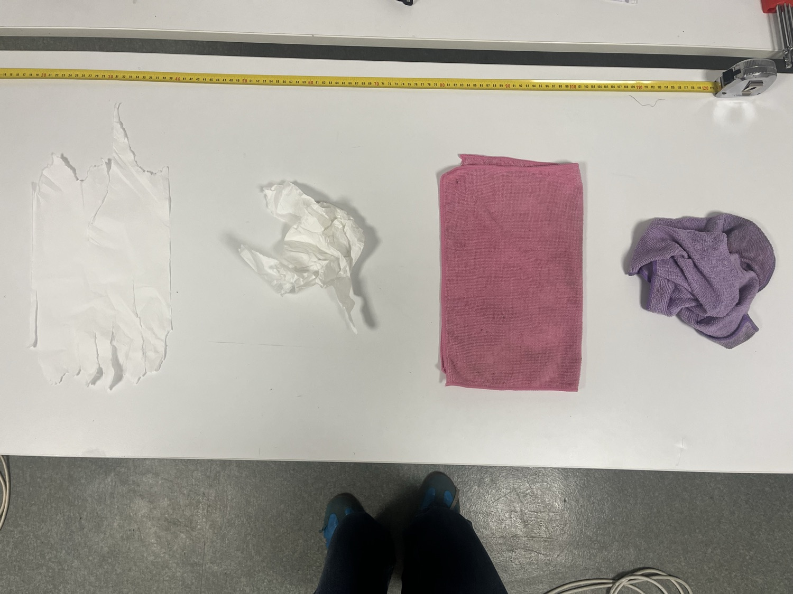

Four cloths crossed by **colour × how they were laid**: white flat, white crumpled, pink folded
flat, purple bundled. Crumpling changes height (a few mm flat, 30–40 mm bundled) without
changing colour or material; colour changes contrast without changing height. The predictions
are explicit:

| | depth | RGB on bare floor | RGB on white poster |
|---|---|---|---|
| purple bundled | should find it (raised) | easy (coloured) | easy |
| pink flat | should miss it (flat) | easy (coloured) | easy |
| white crumpled | should find it (raised) | moderate | hard |
| **white flat** | **should miss it (flat)** | moderate | **neither modality has a cue** |

The white flat rag on the white poster is the single hardest object in the dataset: near-zero
height and near-zero contrast. It is the one case where a fusion model has nothing to fuse, and
all three RGB models do indeed miss it.

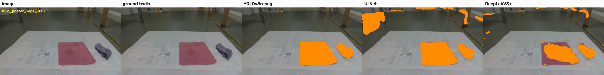

### 8. Empty floor

One run per block with nothing on the ground. No labelling is needed and every predicted pixel
is wrong by construction, which makes it the only **false-positive** measurement in the
project — ISOD has no empty-floor frames at all. It turned out to separate the models more
sharply than any other condition.

---

## 3. The grid

| | bare floor | white poster |
|---|---|---|
| **camera 52 cm, tilt 30°** | 7 sets × 3 distances + empty | cables, chess, rags × 3 distances + empty |
| **camera 25 cm, tilt 21°** | 7 sets × 3 distances + empty | cables, chess, rags × 3 distances + empty |

The poster was shot for **cables, chess and rags** specifically, because those are the three
sets containing both pale and dark versions of the same object. Flipping the background flips
which half is hard to see while the geometry stays fixed — that is what makes the contrast
comparison a controlled one rather than a correlation.

**Five frames per run**, taken from the middle of a 3-second recording with the camera and
scene static. They do not add scenes; they measure how much a prediction moves under sensor
noise alone, and they stop one unlucky frame from driving a cell of the grid.

Run names are `<height>_<background>_<set>_<distance>`, e.g. `h25_poster_rags_150`.

---

## 4. Frames

```
data/OWN/<run>/
  rgb/<i>.png      640x362 colour, 8-bit BGR
  depth/<i>.png    640x362 uint16, millimetres, 0 = no reading, aligned to the colour frame
  gt/<i>.png       640x362 uint8, 255 = obstacle
  floor.png        640x362 uint8, 255 = scored region (the fitted ground plane)
  i = 0..4
```

Same layout as ISOD, so `eval.py` and `analyze_objects.py` run unchanged.

Frames are the full 848×480 sensor output scaled uniformly — **no crop**. An earlier version
centre-cropped to ISOD's 1.517 aspect and threw away **8.2% of the obstacle pixels**, because
the D435's colour lens (70°) is already much narrower than its depth lens (90°) and the
aligned frames live on the colour grid. The uniform scale also lands closer to ISOD's angular
resolution: 9.1 px per degree against ISOD's 7.1, where the crop gave 10.3.

**Depth alignment** (`code/db3_to_frames.py`) is done in numpy, because `pyrealsense2` has no
macOS-arm64 wheel. It is the same forward projection `rs2::align` performs — deproject, rigid
transform, reproject, keep the nearest hit — using this camera's own calibration (depth
`fx = fy = 423.55`, colour `fx = 608.15`, `fy = 606.93`, baseline 15.06 mm), with a 2×2 splat
because the colour stream has 1.44× the focal length and a bare forward map leaves a grid of
holes. Verified: after alignment, depth discontinuities land on 1.38× the mean colour gradient
versus 1.14× before, spurious depth edges fall from 876 to 283, and valid coverage rises from
98.2% to 99.4%.

The stereo shadow down the left edge remains — the first ~20 columns have no depth at all,
since depth comes from the left IR imager — and is most of the 6.8% invalid-depth rate against
ISOD's 1.3%. Cropping it away would also have cut real obstacles, so it is kept and reported.

---

## 5. Ground truth, without hand labelling

`code/own_gt.py`. Every run in a group was shot from the same pose at the same tape line with a
**different set of objects**, so the per-pixel median across the group is the empty scene: an
obstacle occupies a pixel in one set out of seven, never in the majority. Differencing each
frame against that median gives the obstacle mask.

This is also the only thing that works on the poster runs. The poster moves with the objects,
so a fixed empty reference is useless — but the poster is present in *every* run of a distance
group, so the median puts it in the background where it belongs.

Three corrections:

- **Registration.** The tripod was nudged during the session, so every frame is aligned to its
  group anchor by phase correlation on the top third of the image: wall and furniture, never
  floor.
- **Gain matching.** Auto-exposure was on, so each frame is scaled to the background's median
  brightness over the floor before differencing.
- **Hysteresis.** A component survives only if it contains a pixel more than 45 levels from the
  background, grown down to 18. Glossy floor reflections shift by a few levels across broad
  areas and never reach the high threshold; a real object has a hard core.

The scored region (`floor.png`) is the ground plane fitted to the group's median depth, with a
tolerance growing as `z²` to match the stereo noise. Walls, furniture and anyone walking past
fall outside it, which is ISOD's ignore convention.

**Validation.** On the empty-scene runs the method returns **0 objects and 0 px** wherever
registration succeeded — that is the noise floor of the whole procedure. On `rags` it finds
exactly the four rags including the white one; on `chess`, exactly the four pieces.

### Reliability

Registration fails on some runs of the 52 cm block, where people moving at the desk break the
phase correlation. Each run therefore carries a flag: the share of the scored floor marked as
obstacle, a few per cent for a sane scene. Reliability is measured where nothing should have changed: the mean difference between a
registered, gain-matched frame and its group background over the **static top band** — wall and
furniture, never floor. That does not punish a run for containing a physically large object,
which an earlier "share of floor flagged" criterion did. A run is **unreliable** above a
residual of 14 levels (the distribution runs 2.6 at the 10th percentile to 30 at the 95th), or
if it flags more than 35% of the floor, or 2% for an empty run.

**51 of 64 runs pass.** The unreliable ones stay in the dataset — the RGB and depth frames are
fine, only the automatic mask is suspect — but they are excluded from every metric. The flag is
in `dataset_index.csv` and `data/OWN/gt_summary.json`.

---

## 6. What the models do on it

The three ISOD-trained RGB models, frozen: no fine-tuning, same threshold.

| Method | IoU | Precision | Recall | ISOD IoU |
|---|---|---|---|---|
| **YOLOv8n-seg** | **0.267** | 0.535 | 0.347 | 0.744 |
| DeepLabV3+ (MobileNetV2) | 0.208 | 0.344 | 0.345 | 0.757 |
| U-Net (MobileNetV2) | 0.176 | 0.250 | 0.374 | 0.776 |

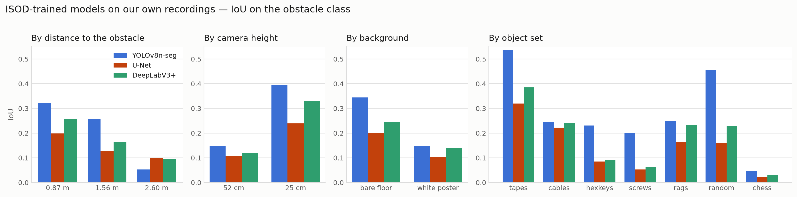

Three findings, each tied to a configuration above:

- **Transfer is poor and the ranking inverts.** Every model loses two thirds to four fifths of
  its ISOD IoU, and YOLOv8n-seg — the weakest of the three on ISOD — is the strongest here.
- **Mounting height beats architecture.** On bare floor at 52 cm, YOLO scores
  0.487 / 0.180 / 0.042 across the three distances; at 25 cm, 0.715 / 0.464 / 0.419. Overall
  IoU rises by half or more for every model. That is why both heights were shot, and the depth geometry predicted the direction
  before any data existed.
- **The semantic models hallucinate on bare floor.** On the empty runs U-Net predicts 8,999
  obstacle px per frame and DeepLabV3+ 4,657, while YOLO predicts **zero**. That is invisible
  on ISOD, which has no empty-floor frames.

Depth and RGB-D are not in this table yet: those checkpoints live in a collaborator's home
directory on the GPU server and are not readable from this account. The aligned depth is in the
dataset and the training script is on the `juan-rgbd` branch, so it is a retrain away.

---

## 7. Limitations

- **One room, one floor type** plus a poster. Site-to-site variation is not measurable here.
- Our D435 is not ISOD's D455: colour FoV 70°×43° against 90°×65°, so the same object covers
  about 1.45× more pixels at a given distance; stereo baseline 50 mm against 95 mm, so depth is
  roughly half as precise at range.
- Ground truth is derived, not drawn. It inherits whatever the median background missed and it
  cannot separate an object from its own shadow.
- ISOD's frames come from handheld walking video and carry motion blur; these are static shots,
  so they are *cleaner* than the training distribution.
- Objects are deliberately placed and spaced, so density and occlusion are far more benign than
  a real warehouse floor.

---

## 8. Regenerating

The `.db3` recordings (8.5 GB) are not in the repository. From them:

```bash
python code/db3_to_frames.py      # .db3 -> data/OWN/<run>/{rgb,depth}
python code/own_gt.py             # -> gt/, floor.png, gt_summary.json
```

Then on the GPU server:

```bash
rsync -az data/OWN shire:/data/cs_courses/jdusza_itr/
CUDA_VISIBLE_DEVICES=1 python predict_own.py --root /data/cs_courses/jdusza_itr
rsync -az shire:/data/cs_courses/jdusza_itr/OWN_pred data/
python code/eval_own.py && python code/plot_own.py
```

## 9. Every run

One row per recording: the columns of [`dataset_index.csv`](dataset_index.csv) with the scene
it belongs to. GitHub renders a `.csv` as a table but shows HTML in a cell as literal text, so
a thumbnail column only displays in Markdown — the CSV carries the image path instead, in its
`thumbnail` column, so the two line up for any tooling. `GT objects` and
`GT area px` are what the automatic ground truth found, averaged over the five frames;
`floor flagged` is the share of the scored floor it marked as obstacle, and `reliable` is the
registration-residual check from §5 — a `no` means the frames and predictions are fine but the
derived mask is not trusted, so the run is excluded from every metric.

| setup | run | height | background | set | classes | items | ground dist | slant | frames | GT objects | GT area px | floor frac | floor flagged | reliable |
|---|---|---|---|---|---|---|---|---|---|---|---|---|---|---|
| 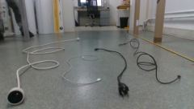 | `h25_floor_cables_075` | 25 | floor | cables | C1 thin-linear | 4 cables: black thin, black thick, white thin, white thick | 0.75 | 0.87 | 5 | 9.2 | 15201 | 70% | 9.4% | yes |
| 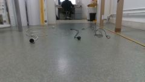 | `h25_floor_cables_150` | 25 | floor | cables | C1 thin-linear | 4 cables: black thin, black thick, white thin, white thick | 1.5 | 1.56 | 5 | 4.8 | 3472 | 71% | 2.1% | yes |
| 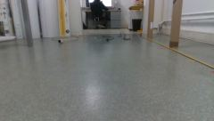 | `h25_floor_cables_250` | 25 | floor | cables | C1 thin-linear | 4 cables: black thin, black thick, white thin, white thick | 2.5 | 2.6 | 5 | 3.0 | 877 | 71% | 0.5% | yes |
| 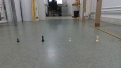 | `h25_floor_chess_075` | 25 | floor | chess | C4 raised | white/black queen and pawn | 0.75 | 0.87 | 5 | 4.0 | 1118 | 70% | 0.7% | yes |
| 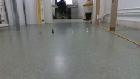 | `h25_floor_chess_150` | 25 | floor | chess | C4 raised | white/black queen and pawn | 1.5 | 1.56 | 5 | 4.0 | 335 | 71% | 0.2% | yes |
| 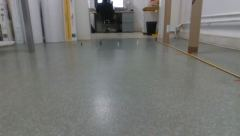 | `h25_floor_chess_250` | 25 | floor | chess | C4 raised | white/black queen and pawn | 2.5 | 2.6 | 5 | 4.0 | 128 | 71% | 0.1% | yes |
| 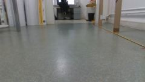 | `h25_floor_empty` | 25 | floor | empty | (none) | nothing |  |  | 5 | 0.0 | 0 | 70% | 0.0% | yes |
|  | `h25_floor_hexkeys_075` | 25 | floor | hexkeys | C1/C3 thin metal | 5 hex keys of different size | 0.75 | 0.87 | 5 | 3.2 | 1867 | 70% | 1.2% | yes |
|  | `h25_floor_hexkeys_150` | 25 | floor | hexkeys | C1/C3 thin metal | 5 hex keys of different size | 1.5 | 1.56 | 5 | 2.0 | 191 | 71% | 0.1% | yes |
|  | `h25_floor_hexkeys_250` | 25 | floor | hexkeys | C1/C3 thin metal | 5 hex keys of different size | 2.5 | 2.6 | 5 | 0.0 | 0 | 71% | 0.0% | yes |
| 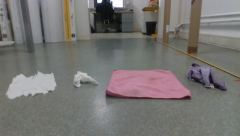 | `h25_floor_rags_075` | 25 | floor | rags | C2 flat-soft | white flat, white crumpled, pink folded, purple bundled | 0.75 | 0.87 | 5 | 4.0 | 30143 | 70% | 18.6% | **no** |
| 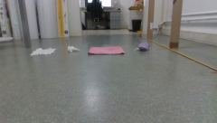 | `h25_floor_rags_150` | 25 | floor | rags | C2 flat-soft | white flat, white crumpled, pink folded, purple bundled | 1.5 | 1.56 | 5 | 4.0 | 4739 | 71% | 2.9% | yes |
|  | `h25_floor_rags_250` | 25 | floor | rags | C2 flat-soft | white flat, white crumpled, pink folded, purple bundled | 2.5 | 2.6 | 5 | 4.0 | 1507 | 71% | 0.9% | yes |
| 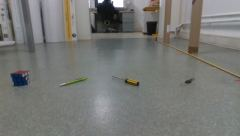 | `h25_floor_random_075` | 25 | floor | random | C3/C4 mixed | screwdriver, Rubik's cube, pen, keycap remover | 0.75 | 0.87 | 5 | 4.0 | 3796 | 70% | 2.4% | yes |
| 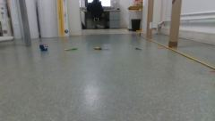 | `h25_floor_random_150` | 25 | floor | random | C3/C4 mixed | screwdriver, Rubik's cube, pen, keycap remover | 1.5 | 1.56 | 5 | 4.0 | 1071 | 71% | 0.7% | yes |
| 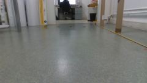 | `h25_floor_random_250` | 25 | floor | random | C3/C4 mixed | screwdriver, Rubik's cube, pen, keycap remover | 2.5 | 2.6 | 5 | 2.0 | 264 | 71% | 0.2% | yes |
|  | `h25_floor_screws_075` | 25 | floor | screws | C3 small-compact | 5 single screws + 1 pile | 0.75 | 0.87 | 5 | 3.0 | 490 | 70% | 0.3% | yes |
|  | `h25_floor_screws_150` | 25 | floor | screws | C3 small-compact | 5 single screws + 1 pile | 1.5 | 1.56 | 5 | 0.4 | 18 | 71% | 0.0% | yes |
|  | `h25_floor_screws_250` | 25 | floor | screws | C3 small-compact | 5 single screws + 1 pile | 2.5 | 2.6 | 5 | 0.0 | 0 | 71% | 0.0% | yes |
| 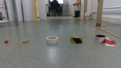 | `h25_floor_tapes_075` | 25 | floor | tapes | C4 raised | 5 tape rolls of different diameter | 0.75 | 0.87 | 5 | 5.0 | 10463 | 70% | 6.5% | yes |
| 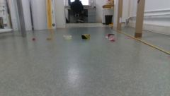 | `h25_floor_tapes_150` | 25 | floor | tapes | C4 raised | 5 tape rolls of different diameter | 1.5 | 1.56 | 5 | 6.0 | 1982 | 71% | 1.2% | yes |
| 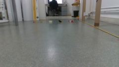 | `h25_floor_tapes_250` | 25 | floor | tapes | C4 raised | 5 tape rolls of different diameter | 2.5 | 2.6 | 5 | 5.2 | 994 | 71% | 0.6% | yes |
| 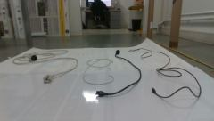 | `h25_poster_cables_075` | 25 | poster | cables | C1 thin-linear | 4 cables: black thin, black thick, white thin, white thick | 0.75 | 0.87 | 5 | 7.4 | 15795 | 72% | 9.5% | yes |
| 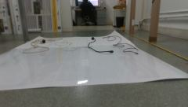 | `h25_poster_cables_150` | 25 | poster | cables | C1 thin-linear | 4 cables: black thin, black thick, white thin, white thick | 1.5 | 1.56 | 5 | 2.6 | 58202 | 74% | 34.2% | **no** |
| 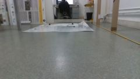 | `h25_poster_cables_250` | 25 | poster | cables | C1 thin-linear | 4 cables: black thin, black thick, white thin, white thick | 2.5 | 2.6 | 5 | 7.4 | 2318 | 73% | 1.4% | yes |
| 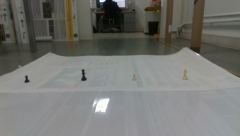 | `h25_poster_chess_075` | 25 | poster | chess | C4 raised | white/black queen and pawn | 0.75 | 0.87 | 5 | 8.8 | 15522 | 72% | 9.3% | yes |
| 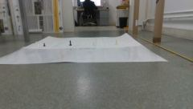 | `h25_poster_chess_150` | 25 | poster | chess | C4 raised | white/black queen and pawn | 1.5 | 1.56 | 5 | 3.0 | 45570 | 74% | 26.8% | **no** |
| 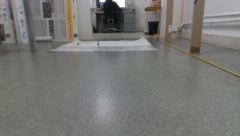 | `h25_poster_chess_250` | 25 | poster | chess | C4 raised | white/black queen and pawn | 2.5 | 2.6 | 5 | 4.4 | 4970 | 73% | 2.9% | yes |
| 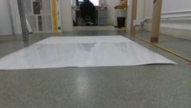 | `h25_poster_empty` | 25 | poster | empty | (none) | nothing |  |  | 5 | 3.0 | 50219 | 73% | 29.7% | **no** |
| 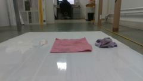 | `h25_poster_rags_075` | 25 | poster | rags | C2 flat-soft | white flat, white crumpled, pink folded, purple bundled | 0.75 | 0.87 | 5 | 5.0 | 19035 | 72% | 11.4% | yes |
| 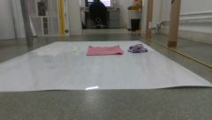 | `h25_poster_rags_150` | 25 | poster | rags | C2 flat-soft | white flat, white crumpled, pink folded, purple bundled | 1.5 | 1.56 | 5 | 5.4 | 35654 | 74% | 20.9% | **no** |
| 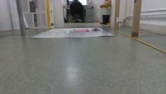 | `h25_poster_rags_250` | 25 | poster | rags | C2 flat-soft | white flat, white crumpled, pink folded, purple bundled | 2.5 | 2.6 | 5 | 8.0 | 2592 | 73% | 1.5% | yes |
| 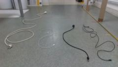 | `h52_floor_cables_075` | 52 | floor | cables | C1 thin-linear | 4 cables: black thin, black thick, white thin, white thick | 0.75 | 0.87 | 5 | 8.0 | 8910 | 93% | 4.1% | yes |
| 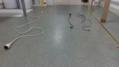 | `h52_floor_cables_150` | 52 | floor | cables | C1 thin-linear | 4 cables: black thin, black thick, white thin, white thick | 1.5 | 1.56 | 5 | 18.4 | 13437 | 94% | 6.2% | yes |
| 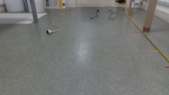 | `h52_floor_cables_250` | 52 | floor | cables | C1 thin-linear | 4 cables: black thin, black thick, white thin, white thick | 2.5 | 2.6 | 5 | 13.8 | 7470 | 94% | 3.4% | yes |
| 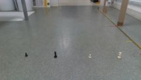 | `h52_floor_chess_075` | 52 | floor | chess | C4 raised | white/black queen and pawn | 0.75 | 0.87 | 5 | 4.0 | 1067 | 93% | 0.5% | yes |
| 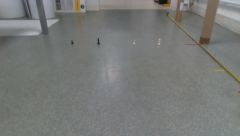 | `h52_floor_chess_150` | 52 | floor | chess | C4 raised | white/black queen and pawn | 1.5 | 1.56 | 5 | 4.0 | 317 | 94% | 0.1% | yes |
| 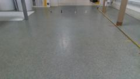 | `h52_floor_chess_250` | 52 | floor | chess | C4 raised | white/black queen and pawn | 2.5 | 2.6 | 5 | 10.2 | 1802 | 94% | 0.8% | yes |
| 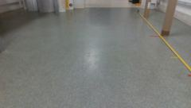 | `h52_floor_empty` | 52 | floor | empty | (none) | nothing |  |  | 5 | 7.4 | 19961 | 94% | 9.2% | **no** |
|  | `h52_floor_hexkeys_075` | 52 | floor | hexkeys | C1/C3 thin metal | 5 hex keys of different size | 0.75 | 0.87 | 5 | 3.0 | 3116 | 93% | 1.4% | yes |
|  | `h52_floor_hexkeys_150` | 52 | floor | hexkeys | C1/C3 thin metal | 5 hex keys of different size | 1.5 | 1.56 | 5 | 0.0 | 0 | 94% | 0.0% | yes |
|  | `h52_floor_hexkeys_250` | 52 | floor | hexkeys | C1/C3 thin metal | 5 hex keys of different size | 2.5 | 2.6 | 5 | 9.2 | 2678 | 94% | 1.2% | yes |
|  | `h52_floor_rags_075` | 52 | floor | rags | C2 flat-soft | white flat, white crumpled, pink folded, purple bundled | 0.75 | 0.87 | 5 | 13.4 | 42149 | 93% | 19.5% | **no** |
|  | `h52_floor_rags_150` | 52 | floor | rags | C2 flat-soft | white flat, white crumpled, pink folded, purple bundled | 1.5 | 1.56 | 5 | 3.2 | 31376 | 94% | 14.5% | **no** |
|  | `h52_floor_rags_250` | 52 | floor | rags | C2 flat-soft | white flat, white crumpled, pink folded, purple bundled | 2.5 | 2.6 | 5 | 6.0 | 28635 | 94% | 13.2% | **no** |
|  | `h52_floor_random_075` | 52 | floor | random | C3/C4 mixed | screwdriver, Rubik's cube, pen, keycap remover | 0.75 | 0.87 | 5 | 4.0 | 2908 | 93% | 1.4% | yes |
|  | `h52_floor_random_150` | 52 | floor | random | C3/C4 mixed | screwdriver, Rubik's cube, pen, keycap remover | 1.5 | 1.56 | 5 | 3.4 | 857 | 94% | 0.4% | yes |
|  | `h52_floor_random_250` | 52 | floor | random | C3/C4 mixed | screwdriver, Rubik's cube, pen, keycap remover | 2.5 | 2.6 | 5 | 9.4 | 1951 | 94% | 0.9% | yes |
|  | `h52_floor_screws_075` | 52 | floor | screws | C3 small-compact | 5 single screws + 1 pile | 0.75 | 0.87 | 5 | 2.0 | 660 | 93% | 0.3% | yes |
|  | `h52_floor_screws_150` | 52 | floor | screws | C3 small-compact | 5 single screws + 1 pile | 1.5 | 1.56 | 5 | 0.0 | 0 | 94% | 0.0% | yes |
|  | `h52_floor_screws_250` | 52 | floor | screws | C3 small-compact | 5 single screws + 1 pile | 2.5 | 2.6 | 5 | 10.0 | 2690 | 94% | 1.2% | yes |
|  | `h52_floor_tapes_075` | 52 | floor | tapes | C4 raised | 5 tape rolls of different diameter | 0.75 | 0.87 | 5 | 5.0 | 8212 | 93% | 3.8% | yes |
|  | `h52_floor_tapes_150` | 52 | floor | tapes | C4 raised | 5 tape rolls of different diameter | 1.5 | 1.56 | 5 | 5.0 | 2722 | 94% | 1.3% | yes |
|  | `h52_floor_tapes_250` | 52 | floor | tapes | C4 raised | 5 tape rolls of different diameter | 2.5 | 2.6 | 5 | 13.0 | 3415 | 94% | 1.6% | yes |
|  | `h52_poster_cables_075` | 52 | poster | cables | C1 thin-linear | 4 cables: black thin, black thick, white thin, white thick | 0.75 | 0.87 | 5 | 9.2 | 41189 | 94% | 18.9% | **no** |
|  | `h52_poster_cables_150` | 52 | poster | cables | C1 thin-linear | 4 cables: black thin, black thick, white thin, white thick | 1.5 | 1.56 | 5 | 13.2 | 38523 | 94% | 17.7% | **no** |
|  | `h52_poster_cables_250` | 52 | poster | cables | C1 thin-linear | 4 cables: black thin, black thick, white thin, white thick | 2.5 | 2.6 | 5 | 10.0 | 13167 | 92% | 6.2% | yes |
|  | `h52_poster_chess_075` | 52 | poster | chess | C4 raised | white/black queen and pawn | 0.75 | 0.87 | 5 | 3.2 | 21495 | 94% | 9.9% | yes |
|  | `h52_poster_chess_150` | 52 | poster | chess | C4 raised | white/black queen and pawn | 1.5 | 1.56 | 5 | 3.4 | 3385 | 94% | 1.6% | yes |
|  | `h52_poster_chess_250` | 52 | poster | chess | C4 raised | white/black queen and pawn | 2.5 | 2.6 | 5 | 3.2 | 28892 | 92% | 13.6% | **no** |
|  | `h52_poster_empty` | 52 | poster | empty | (none) | nothing |  |  | 5 | 10.8 | 19250 | 94% | 8.9% | **no** |
|  | `h52_poster_rags_075` | 52 | poster | rags | C2 flat-soft | white flat, white crumpled, pink folded, purple bundled | 0.75 | 0.87 | 5 | 0.0 | 0 | 94% | 0.0% | yes |
|  | `h52_poster_rags_150` | 52 | poster | rags | C2 flat-soft | white flat, white crumpled, pink folded, purple bundled | 1.5 | 1.56 | 5 | 10.8 | 41686 | 94% | 19.2% | **no** |
|  | `h52_poster_rags_250` | 52 | poster | rags | C2 flat-soft | white flat, white crumpled, pink folded, purple bundled | 2.5 | 2.6 | 5 | 9.4 | 20787 | 92% | 9.8% | yes |
